# Manual de usuario — Panel de Administración (Admin)

Esta guía explica, cómo entrar y usar el panel de administración de SaludPortal (el "Admin"). No requiere conocimientos técnicos.

Si necesitás información sobre cómo funciona el sistema por dentro (para desarrolladores), consultá
[telemetria-y-logs.md](telemetria-y-logs.md).
## ¿Qué es el Admin?

El Admin es un panel interno donde se pueden consultar dos tipos de información que genera el
portal de pacientes:

- **Logs**: son los "registros técnicos" que el sistema va guardando mientras funciona. Sirven
sobre todo para detectar errores.
- **Telemetría**: son los eventos de uso de los pacientes: qué páginas visitan, en qué botones
hacen clic, qué documentos descargan, etc. Sirve para entender cómo se usa el portal.

Algunos términos que vas a encontrar:

| Término           | Qué significa                                                                            |
| ----------------- | ---------------------------------------------------------------------------------------- |
| **Evento**        | Una acción registrada: ver una página, hacer clic, descargar un PDF, etc.                |
| **Log**           | Un mensaje técnico del sistema (información, advertencia o error).                       |
| **Sesión**        | Un período de uso del portal por parte de un mismo paciente, desde que inicia sesión.    |
| **PacienteId**    | El identificador interno del paciente en el sistema (no es su documento).                |
| **Mapa de calor** | Un mapa donde se ven "manchas" de color según dónde se concentran más eventos o errores. |

## Cómo entrar

1. Abrí el navegador y entrá al sitio web (página de inicio).
2. Si no estás autenticado, vas a ver el banner de Mi Salud a la izquierda y el formulario **Acceso Admin** a la derecha, con el texto "Panel de gestion de eventos y logs."
3. Completá **Email** y **Contraseña** con las credenciales que te hayan dado.
4. Hacé clic en **Ingresar**. Tras un acceso correcto vas directo al **Dashboard**.

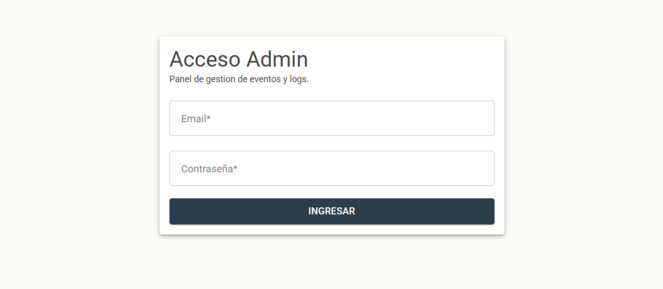

**Duración de la sesión**: una vez que entrás, la sesión permanece activa durante **8 horas** de
uso continuo. Pasado ese tiempo, el sistema te va a pedir que vuelvas a iniciar sesión.

**Para salir**: hacé clic en el botón **Salir**, ubicado en la barra superior.

**No hay recuperación de contraseña automática.** Si olvidaste tu contraseña, pedile a otro
administrador que te la cambie desde la sección [Usuarios](#usuarios).

## Recorrido general de la pantalla

- **Barra superior**: muestra el título "Salud Portal - Admin", tu email y el botón **Salir**.
También hay un ícono de sol/luna para cambiar entre **modo claro** y **modo oscuro**; la
preferencia se guarda en tu navegador.
- **Menú lateral** (se abre con el ícono de hamburguesa): permite navegar a todas las secciones
del panel:
  - **Dashboard**
  - **Logs** → Lista / Mapa de calor
  - **Telemetria** → Lista / Mapa de calor
  - **Exportaciones** → Logs / Telemetría
  - **Usuarios**

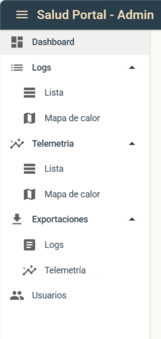

## Dashboard

Es la pantalla principal luego de iniciar sesión (`/dashboard`). Al entrar se muestra un saludo
de bienvenida con el email del usuario autenticado, y debajo un resumen del día:

- **Eventos hoy**: cantidad total de eventos de uso registrados hoy, con una etiqueta por cada
tipo (por ejemplo, cuántas vistas de página, cuántos clics, cuántas descargas).
- **Pacientes activos hoy**: cantidad de sesiones distintas de pacientes con actividad hoy.
- **Errores hoy**: cantidad de errores del sistema registrados hoy. Se muestra en rojo si hay
errores y en verde si no hay ninguno. Tiene un botón **Ver logs** para ir directo al listado de
logs.
- **Top páginas (últimos 7 días)**: qué páginas del portal fueron las más visitadas en la última
semana.
- **Dispositivos (últimos 7 días)**: desde qué tipo de dispositivo (celular, computadora, etc.)
se conectaron los pacientes en la última semana.
- **Logs recientes (Error / Warning)**: los últimos 8 registros de error o advertencia, con fecha
y hora, para tener una alerta temprana de problemas.

Si todavía no hay información para mostrar en algún bloque, vas a ver el texto **Sin datos.** Si
no hubo errores recientes, vas a ver un mensaje verde: **Sin errores recientes.**

> **Nota**: las estadísticas "de hoy" usan el día calendario en horario de Argentina (UTC−3).

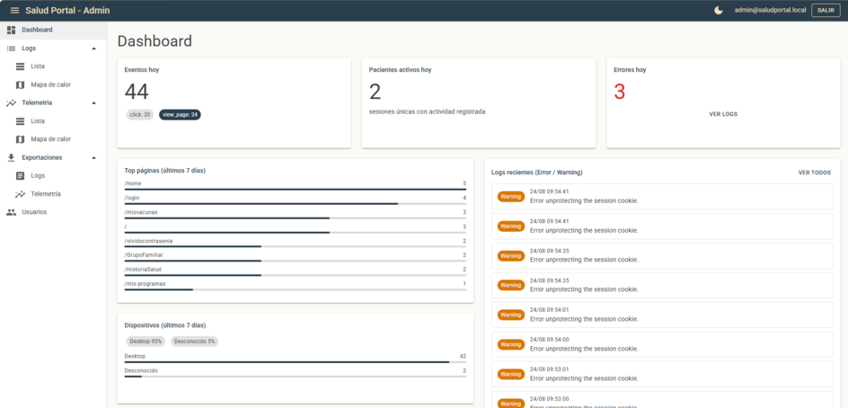

## Logs del sitio

Ruta: **Logs → Lista** (`/logs`). Acá se ven todos los registros técnicos generados por el
portal de pacientes.

### Filtros disponibles

| Filtro                          | Para qué sirve                                                                      |
| ------------------------------- | ----------------------------------------------------------------------------------- |
| **Buscar**                      | Busca coincidencias en el mensaje o la categoría del log.                           |
| **Nivel**                       | Filtra por gravedad: Debug, Information, Warning, Error o Critical (ver más abajo). |
| **Desde** / **Hasta**           | Rango de fechas (formato día/mes/año).                                              |
| **Hora desde** / **Hora hasta** | Rango de horas dentro de esas fechas.                                               |

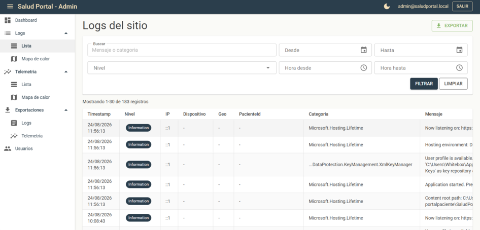

Los botones **Filtrar** y **Limpiar** aplican o resetean los filtros.

### Qué significa cada nivel

| Nivel           | Significado en palabras simples                                         |
| --------------- | ----------------------------------------------------------------------- |
| **Debug**       | Detalle técnico interno, normalmente no relevante fuera del desarrollo. |
| **Information** | Información normal de funcionamiento, sin problemas.                    |
| **Warning**     | Algo que no impidió el funcionamiento, pero conviene revisar.           |
| **Error**       | Algo falló y afectó una acción puntual.                                 |
| **Critical**    | Un fallo grave que puede afectar a muchos usuarios.                     |

### La tabla de resultados

Cada fila muestra: fecha y hora, nivel, IP del visitante, dispositivo, ubicación aproximada,
identificador del paciente (si corresponde), categoría del log y un resumen del mensaje. Se
muestran **30 registros por página**, con paginación al pie.

Si no hay resultados con los filtros elegidos, vas a ver: **No se encontraron registros.**

### Ver el detalle de un log

Hacé clic en **Ver** en cualquier fila para abrir el detalle completo, que incluye:

- Fecha y hora exacta, nivel y categoría.
- Identificador del paciente y de la sesión (con botón para copiar).
- Dirección IP, tipo de dispositivo y navegador.
- Ubicación aproximada, con un enlace para abrirla en Google Maps (si el sistema pudo
determinarla).
- El mensaje completo del log y, si corresponde, el detalle técnico del error (excepción).

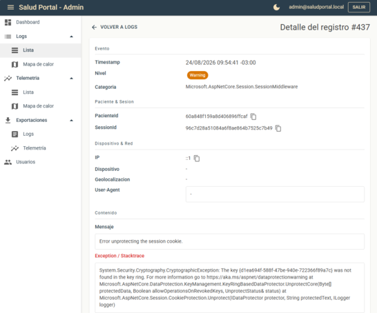

Si el registro no existe (por ejemplo, un enlace viejo), vas a ver: **Registro no encontrado.**

## Mapa de calor de logs

Ruta: **Logs → Mapa de calor** (`/logs/mapa`). Muestra en un mapa las zonas geográficas desde
donde se generaron más logs, coloreadas de azul (menos) a rojo (más).

Podés filtrar por **Desde**, **Hasta** y **Nivel**, y aplicar con el botón **Aplicar** o volver a
los valores por defecto con **Limpiar**. Un contador arriba indica cuántos puntos se cargaron en
el mapa.

> El mapa solo puede mostrar registros que tengan una ubicación geográfica asociada. Si el
> paciente no dio permiso de ubicación en su navegador, ese registro no va a aparecer en el mapa
> (aunque sí en la lista de logs).

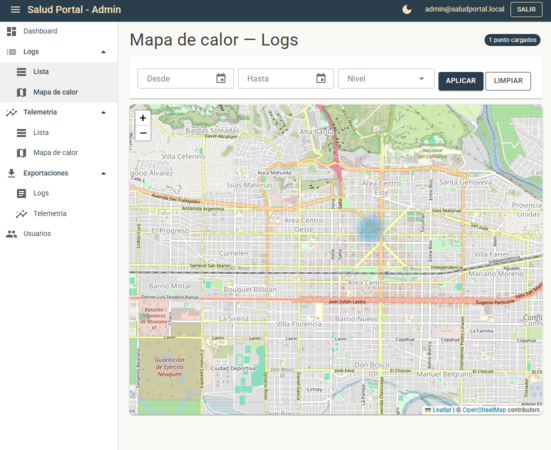

## Telemetría de uso

Ruta: **Telemetria → Lista** (`/telemetry`). Acá se ve la actividad de los pacientes dentro del
portal.

### Tipos de evento

| Evento         | Qué representa                                              |
| -------------- | ----------------------------------------------------------- |
| `view_page`    | El paciente abrió una página del portal.                    |
| `click`        | El paciente hizo clic en un botón o enlace.                 |
| `download_pdf` | El paciente descargó un documento en PDF.                   |
| `view_image`   | El paciente visualizó una imagen (por ejemplo, un estudio). |
| `copy_link`    | El paciente copió un enlace.                                |

### Filtros disponibles

Además de **Buscar** (por ruta, botón o detalle), **Evento**, **Desde/Hasta** y **Hora
desde/hasta** (igual que en logs), acá también podés filtrar por **PacienteId** para ver la
actividad de un paciente puntual.

### La tabla y el detalle

La tabla muestra 30 eventos por página, ordenados del más reciente al más antiguo, con columnas
de fecha/hora, tipo de evento, IP, dispositivo, ubicación, página, acción y botón **Ver**.

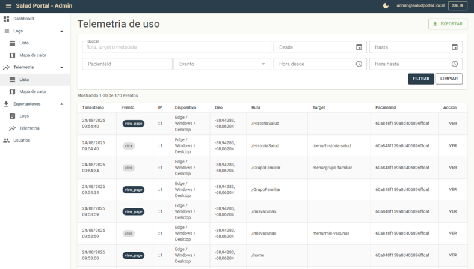

El detalle de un evento (`/telemetry/{id}`) muestra la misma información que el de logs, más un
bloque de **Metadata** con datos adicionales del evento en formato técnico (por ejemplo, el
identificador de un estudio descargado). Si el evento no existe, vas a ver: **Evento no
encontrado.**

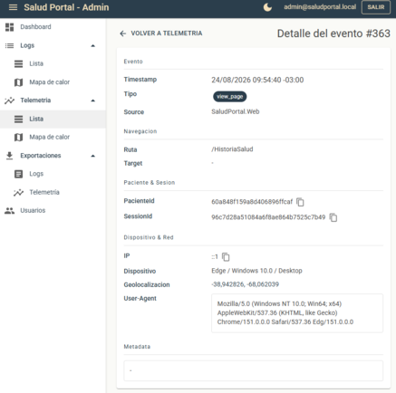

## Mapa de calor de telemetría

Ruta: **Telemetria → Mapa de calor** (`/telemetry/mapa`). Funciona igual que el mapa de calor de
logs, pero mostrando la concentración geográfica de eventos de uso, con filtro por tipo de
evento en lugar de nivel.

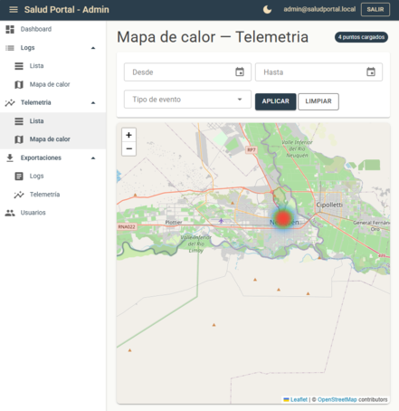

## Exportaciones

Desde acá podés descargar la información para analizarla fuera del panel (por ejemplo, en una
planilla de cálculo).

### Exportar logs

Ruta: **Exportaciones → Logs** (`/export/logs`).

1. Configurá los filtros que necesites: **Buscar**, **Nivel**, fechas y horas.
2. Definí la cantidad máxima de registros a exportar en **Máx. registros** (por defecto 1000,
  como máximo 50.000 — se indica con el texto **Máximo 50.000**).
3. Opcional: hacé clic en **Ver total** para saber cuántos registros coinciden con los filtros
  antes de exportar (mientras calcula, muestra **Consultando…**).
4. Elegí el formato haciendo clic en el botón correspondiente:
  - **CSV**: para abrir en Excel o Google Sheets.
  - **JSON**: para uso técnico o integraciones con otros sistemas.
  - **PDF**: para un informe listo para imprimir o compartir.
5. El archivo se descarga automáticamente con un nombre como `logs_2026-08-24.csv`.

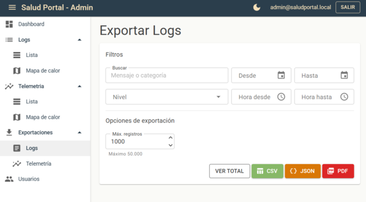

### Exportar telemetría

Ruta: **Exportaciones → Telemetría** (`/export/telemetry`). Funciona igual que la exportación de
logs, pero con filtros propios de telemetría (incluyendo **PacienteId** y **Evento**). El archivo
se llama, por ejemplo, `telemetry_2026-08-24.csv`.

También existe un acceso rápido de exportación desde la lista de Telemetría, con el botón
**Exportar**: abre una ventana más simple donde elegís el formato (CSV, JSON o PDF) y la cantidad
máxima de registros, con el mismo límite de 50.000.

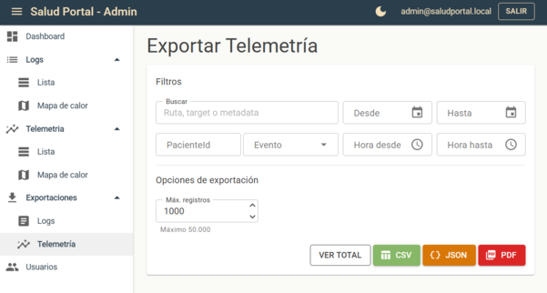

## Usuarios

Ruta: **Usuarios** (`/usuarios`). Acá se gestionan las cuentas de acceso al panel Admin.

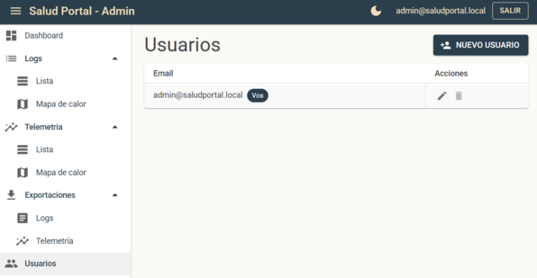

- **Crear un usuario nuevo**: hacé clic en **Nuevo usuario**, completá **Email** y
**Contraseña**, confirmá la contraseña y hacé clic en **Crear**. Vas a ver la confirmación:
**Usuario creado correctamente.**

  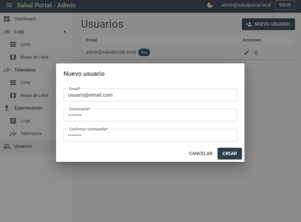

- **Editar un usuario**: hacé clic en el ícono de lápiz (**Editar**) en la fila correspondiente.
Podés cambiar el email y, opcionalmente, dejar la contraseña en blanco si no querés cambiarla.
Al guardar, vas a ver: **Usuario actualizado correctamente.**
- **Eliminar un usuario**: hacé clic en el ícono de basura (**Eliminar**). El sistema pide
confirmación: **¿Eliminar al usuario {email}? Esta acción no se puede deshacer.** Si confirmás,
vas a ver: **Usuario eliminado.**

**Reglas de contraseña**: mínimo 8 caracteres y al menos un número (no exige símbolos
especiales).

**No podés eliminar tu propia cuenta** (el botón aparece deshabilitado en tu propia fila, marcada
con la etiqueta **Vos**). Si necesitás borrar tu usuario, pedile a otro administrador que lo haga.

Si todavía no hay usuarios cargados (situación poco habitual), vas a ver: **No hay usuarios
registrados.**

## Preguntas frecuentes

**No veo datos de hoy en el Dashboard.**
Puede ser que todavía no haya actividad registrada. El corte de "hoy" sigue el día calendario
en horario de Argentina (UTC−3). Probá revisar la lista de Logs o Telemetría con un rango de
fechas más amplio.

**En el detalle de un registro, la ubicación aparece como "-".**
Significa que el paciente no dio permiso de ubicación en su navegador al momento del evento, o
que la ubicación no pudo determinarse. Es una situación normal y frecuente.

**Olvidé mi contraseña.**
No existe una opción de "recuperar contraseña" dentro del panel. Pedile a otro administrador que
te la cambie desde [Usuarios](#usuarios).

**¿En qué horario se muestran las fechas?**
Todas las fechas y horas que ves en las pantallas (tablas, detalle, dashboard) están expresadas
en el horario local del servidor. Los formatos usados son:

| Pantalla                             | Formato                                          |
| ------------------------------------ | ------------------------------------------------ |
| Filtros de fecha                     | día/mes/año                                      |
| Tablas de logs y telemetría          | día/mes/año hora:minuto:segundo                  |
| Detalle de un registro               | día/mes/año hora:minuto:segundo con zona horaria |
| Feed de logs recientes del Dashboard | día/mes hora:minuto:segundo                      |

**¿Cuántos registros puedo ver o exportar por vez?**
Las listas muestran 30 registros por página. Las exportaciones permiten hasta 50.000 registros
por archivo. Los mapas de calor muestran como máximo 5.000 puntos, agrupando los eventos más
cercanos entre sí.

**No encuentro una función que esperaba.**
Si te parece que falta algo o algo no funciona como debería, comunicate con el equipo técnico
indicando la pantalla y los pasos que seguiste.