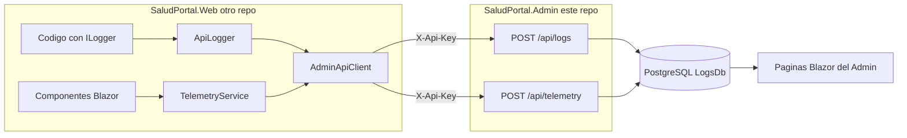

# Telemetría y Logs — Documentación técnica

Este documento explica cómo funciona el pipeline de logs de aplicación y telemetría de uso que
recibe **este** panel (`SaludPortal.Admin`) desde el portal de pacientes (`SaludPortal.Web`, otro
repositorio), cómo configurarlo y cómo verificarlo en local y en producción.

Para el manual de uso del panel Admin ver [manual-admin.md](manual-admin.md).

## 1. Arquitectura general

Existen **dos canales independientes** que viajan por HTTP desde `SaludPortal.Web` hacia este `SaludPortal.Admin` y terminan en la misma base PostgreSQL (`LogsDb`):

1. **Logs de aplicación**: cualquier registro que el código de `SaludPortal.Web` genera a través
  de `ILogger` (información, advertencias, errores) se intercepta automáticamente y se reenvía
   al Admin.
2. **Telemetría de uso**: los componentes Blazor del portal registran explícitamente eventos de
  uso de los pacientes (vistas de página, clics, descargas de documentos).




Ambos canales comparten el mismo transporte (un cliente HTTP con header `X-Api-Key`) y el mismo
enriquecimiento de contexto de cliente (IP, dispositivo, ubicación, paciente y sesión). Este Admin
guarda cada log o evento en PostgreSQL y los expone en el panel para consulta, mapas de calor y
exportación (ver [manual-admin.md](manual-admin.md)).

Cada log o evento se envía como una petición HTTP independiente (sin batching); hay cola y
reintentos en el portal antes de descartar. Ver
[sección 7, Limitaciones conocidas](#7-limitaciones-conocidas).

## 2. Emisión de logs

Todo lo que la aplicación registra con el mecanismo estándar de logging de .NET (`ILogger`) es
interceptado por un proveedor de logging propio en el portal Web, que arma el mensaje y lo envía
por HTTP a este Admin en segundo plano, sin bloquear ni afectar la respuesta al usuario.

- **Nivel mínimo enviado**: `Information` en adelante (`Warning`, `Error`, `Critical`). Los
mensajes de nivel `Debug` o inferior nunca salen del portal.
- **Categorías excluidas a propósito**: los logs generados por el propio cliente HTTP interno
(`System.Net.Http`, `Polly`, `Microsoft.Extensions.Http`) están bloqueados. Sin esta exclusión
se generaría un bucle infinito: cada log dispara una petición HTTP, esa petición genera sus
propios logs de HTTP, esos logs disparan nuevas peticiones, y así sucesivamente.
- Si el envío falla por cualquier motivo (el Admin no responde, se cortó la red, etc.), el error
no se propaga hacia el código que originó el log en el portal (el portal reintenta según su cola).

La **telemetría de uso** (vistas de página, clics, descargas de PDF, visualización de imágenes,
copiado de enlaces) viaja por el mismo transporte HTTP hacia este Admin, pero se dispara de forma
explícita desde los componentes de la interfaz cuando el paciente realiza esas acciones, no desde
el sistema de logging.

### Contexto adjunto a cada log o evento

Además del contenido propio del log o del evento, cada envío incluye información de contexto que
permite luego filtrar y ubicar geográficamente los registros en el panel Admin:


| Dato                                       | Cómo se obtiene                                                                                 |
| ------------------------------------------ | ----------------------------------------------------------------------------------------------- |
| Dirección IP                               | Del encabezado del proxy (`X-Forwarded-For`) o de la conexión directa                           |
| Dispositivo, navegador y sistema operativo | Detectados en el navegador del usuario                                                          |
| Ubicación geográfica (latitud/longitud)    | Geolocalización del navegador, solo si el usuario dio permiso                                   |
| Paciente                                   | Identificador del paciente autenticado, si hay sesión iniciada                                  |
| Sesión                                     | Identificador único generado en cada inicio de sesión, para agrupar eventos de una misma visita |


Si el paciente no otorgó permiso de ubicación, ese dato queda vacío; el resto del log o evento se
envía igual.

## 3. Cómo se configura

Web y Admin viven en **repositorios distintos**. Cada uno tiene su propia configuración; el
acoplamiento es solo por HTTP (URL de este Admin + API key compartida).

El pipeline se activa o desactiva en el portal según `AdminLogs:ApiKey`; este Admin valida cada
petición recibida contra `LogIngestion:*`.


| Clave                                      | Dónde vive (repo)     | Para qué sirve                                                                                                                    |
| ------------------------------------------ | --------------------- | --------------------------------------------------------------------------------------------------------------------------------- |
| `AdminLogs:ApiKey`                         | Web                   | Clave secreta compartida que autentica cada envío a este Admin. **Si está vacía, el portal no envía nada**, sin errores visibles. |
| `AdminLogs:BaseUrl`                        | Web                   | URL de este Admin (Development típico: `https://localhost:7180`).                                                                 |
| `LogIngestion:ApiKey`                      | **Admin (este repo)** | Debe coincidir exactamente con `AdminLogs:ApiKey` del Web; si no coincide, se rechaza el envío.                                   |
| `LogIngestion:RateLimit:*`                 | **Admin (este repo)** | Límite de peticiones de ingesta por minuto (ver [Limitaciones conocidas](#7-limitaciones-conocidas)).                             |
| `LogIngestion:Telemetry:AllowedEventTypes` | **Admin (este repo)** | Tipos de evento de telemetría aceptados; cualquier otro se rechaza.                                                               |
| `ConnectionStrings:LogsDb`                 | **Admin (este repo)** | PostgreSQL donde se guardan logs y telemetría.                                                                                    |
| `AdminUsers`                               | **Admin (este repo)** | Usuarios administradores que pueden iniciar sesión en el panel.                                                                   |


## 4. Cómo probarlo en local

Desde **este** repositorio Admin:

1. Postgres:
  ```bash
   docker run -d --name salud-portal-db \
     -e POSTGRES_DB=salud_logs \
     -e POSTGRES_USER=salud \
     -e POSTGRES_PASSWORD=salud_pass \
     -p 5432:5432 \
     -v postgres_data:/var/lib/postgresql/data \
     postgres:17-alpine
  ```
   Si el contenedor ya existe: `docker start salud-portal-db`.
2. Arrancar este Admin:
  ```bash
   dotnet run --project SaludPortal.Admin
  ```
   URL típica: `https://localhost:7180`.
3. En el **repo Web**, configurar `AdminLogs:BaseUrl=https://localhost:7180` y la misma API key
  que `LogIngestion:ApiKey` de este Admin (`appsettings.Development.json` de cada repo debe
   alinearse). Arrancar el portal.
4. Navegar el portal para generar actividad, entrar a este Admin con un usuario de `AdminUsers`
  (en Development se carga con `dotnet user-secrets`, ver el [README](../README.md#usuarios-administradores-development)) y
  verificar:
  - **Logs → Lista** (`/logs`)
  - **Telemetria → Lista** (`/telemetry`)

Si no aparece nada, revisar que las API keys coincidan y que `AdminLogs:BaseUrl` apunte a este
Admin en ejecución.

## 5. Cómo probarlo en producción

El pipeline funciona igual sin importar cómo se despliegue; lo único que cambia es de dónde sale
la configuración.

### Opción A — Docker (este repo)

```bash
docker build -t salud-admin .
```

Al correr el contenedor, pasar al menos:


| Variable                        | Uso                                            |
| ------------------------------- | ---------------------------------------------- |
| `ConnectionStrings__LogsDb`     | PostgreSQL                                     |
| `LogIngestion__ApiKey`          | Debe coincidir con `AdminLogs__ApiKey` del Web |
| `AdminUsers__N__Email/Password` | Al menos uno, para el primer inicio de sesión  |


En el **repo Web**, configurar `AdminLogs__BaseUrl` con la URL pública o de red de este Admin y la
misma API key.

### Opción B — IIS (Windows Server)

1. Desde este repo:
  ```bash
   dotnet publish SaludPortal.Admin -c Release -o publish/admin
  ```
2. Instalar el **ASP.NET Core Hosting Bundle** y un sitio/Application Pool para Admin.
3. Configurar en este sitio `LogIngestion:*` y `ConnectionStrings:LogsDb` (appsettings o variables
  de entorno del Application Pool). En el sitio del portal Web configurar `AdminLogs:*`.


### Verificación

Navegar el portal de pacientes para generar actividad y luego, con un usuario de `AdminUsers`,
revisar **Logs → Lista** (`/logs`) y **Telemetria → Lista** (`/telemetry`) en este Admin.

## 6. Referencia interactiva de la API con Scalar

En **Development** este Admin publica la documentación OpenAPI de su propia API. Es la forma más
rápida de ver los contratos, parámetros y códigos de respuesta exactos, o de probar una llamada
a mano. En producción no se registran estos endpoints.

```bash
dotnet run --project SaludPortal.Admin
```

- **Interfaz interactiva**: `/scalar/v1`
- **Documento OpenAPI crudo**: `/openapi/v1.json`
- **URL en desarrollo**: `https://localhost:7180/scalar/v1`

Endpoints documentados en Scalar:

- `IngestLogs` — `POST /api/logs` (requiere el header `X-Api-Key`)
- `IngestTelemetry` — `POST /api/telemetry` (requiere el header `X-Api-Key`)
- Endpoints con la etiqueta `Export` — `GET /api/export/logs` y `GET /api/export/telemetry`
(requieren sesión iniciada en el Admin, no API key)

Para probar los endpoints de ingesta desde Scalar hay que cargar manualmente el header
`X-Api-Key`; para probar los de exportación hace falta tener una sesión de Admin iniciada en el
mismo navegador.

## 7. Limitaciones conocidas

- **1 evento = 1 petición HTTP**: no hay agrupamiento de envíos. Con logging muy verboso puede
superarse el límite de peticiones por minuto que acepta el Admin.
- **Geolocalización limitada**: depende de que el navegador del paciente tenga permiso de
ubicación concedido; sin él, la ubicación queda vacía y no hay ningún mecanismo alternativo
para inferirla.

